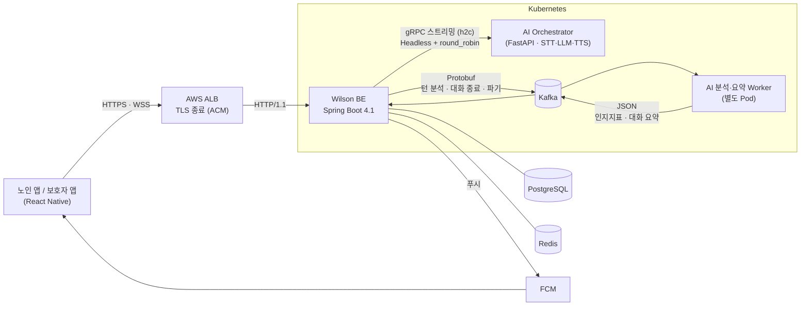
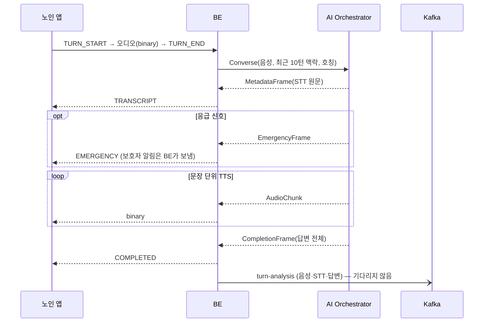

# Wilson Backend

[](https://github.com/hairyung2002/Wilson_Spring_Server/actions/workflows/ci.yml)

치매 어르신에게 **AI가 먼저 안부를 묻고**, 대화에서 읽은 변화를 **보호자에게 전해 주는** 음성 AI 케어 서비스 Wilson의 Spring Boot 서버입니다.

> 2026 글로벌 피우다프로젝트(ICT콤플렉스) 참가작 · 4인 팀 · 이 레포는 Backend 서버 (AI 서버는 별도 레포)

| 상태 | 내용 |
|---|---|
| ✅ BE 구현 완료 | REST API · 음성 WebSocket · gRPC 클라이언트 · Kafka 발행/수신 · 배치 · K8s 매니페스트 |
| ✅ 테스트 709개 | 외부 서비스 없이 `./gradlew test` 하나로 실행 (내장 Kafka · H2 · Mock) |
| ⏳ AI 연동 검증 전 | AI 서버가 [BE가 확정한 계약](docs/ai-integration-contract.md)을 구현하는 중. 응답 속도·처리량은 아직 측정하지 않았습니다 |

---

## 무엇을 하나요

| 사용자 | 기능 |
|---|---|
| **어르신** (노인 기기) | 정해진 시각에 "할머니, 오늘 점심은 뭐 드셨어요?" 알림 → 앱을 열면 Wilson 목소리로 듣고, 음성으로 대답 · 대화 중 낙상·통증 같은 응급 신호 감지 |
| **보호자** (보호자 앱) | 대화 요약 · 말하기 지표 추이 · 평소와 다른 변화 판정 · 응급·무응답 알림 · 일정 관리 · 여러 보호자 공동 돌봄 |

서비스 원칙은 [CLAUDE.md](CLAUDE.md) 1장을 따릅니다. **먼저 다가가고**(선제 안부), **손주처럼 대하고**, 어르신의 말실수·반복·기억 오류를 **교정하거나 지적하지 않습니다**. 그래서 보호자 화면에는 의료 진단처럼 읽히는 표현을 쓰지 않습니다.

---

## 아키텍처



- **실시간 경로**(기다리면 안 됨): 앱 ↔ WebSocket ↔ BE ↔ gRPC 서버 스트리밍 ↔ AI. 음성 조각을 받는 대로 앱에 흘려보냅니다.
- **무거운 경로**(기다리지 않음): 지표 분석·RAG 저장·요약·파기는 Kafka 뒤의 별도 Worker가 처리하고, 결과만 Kafka로 돌아옵니다.

### 음성 한 턴



---

## 핵심 설계 판단과 코드 위치

### D1. 대화는 gRPC 스트리밍, 분석은 메시지 큐 뒤로

음성 대화는 바로 응답해야 하지만 치매 징후 분석은 수 초가 걸립니다. 한 프로세스에서 둘을 같이 돌리면 분석이 대화를 막습니다.

| 무엇 | 어디 |
|---|---|
| 앱 ↔ BE 음성 WebSocket (10MB 한도, 동시 전송 안전) | [`VoiceWebSocketHandler`](src/main/java/com/piuda/wilson/domain/conversation/websocket/VoiceWebSocketHandler.java) · [프로토콜](docs/websocket-voice-protocol.md) |
| 턴 처리: STT·답변 기록 → 앱 전달 → **답변을 보낸 뒤** 분석 요청 발행 | [`VoiceTurnService`](src/main/java/com/piuda/wilson/domain/conversation/service/VoiceTurnService.java) |
| BE → AI Kafka 이벤트 (Protobuf, 음성 바이트 그대로) | [`events.proto`](src/main/proto/wilson/events/v1/events.proto) · [`KafkaAiEventPublisher`](src/main/java/com/piuda/wilson/infrastructure/kafka/KafkaAiEventPublisher.java) |
| 토픽 설정 (원문·음성 토픽 24시간 보관, 메시지 12MB) | [`AiEventKafkaConfig`](src/main/java/com/piuda/wilson/infrastructure/kafka/AiEventKafkaConfig.java) |
| AI → BE 지표·요약 수신 (외부 메시지 검증 후 저장) | [`CognitiveMetricListener`](src/main/java/com/piuda/wilson/infrastructure/kafka/CognitiveMetricListener.java) · [`ConversationSummaryListener`](src/main/java/com/piuda/wilson/infrastructure/kafka/ConversationSummaryListener.java) |

### D2. 고정 TTL 대신 Sliding Expiration

어르신은 대화 사이 침묵이 깁니다. 고정 TTL이면 대화 도중 맥락이 사라집니다.

- 대화 맥락(최근 10턴)을 Redis에 두고, **읽고 쓸 때마다 만료를 30분 연장**합니다.
- 만료되거나 Redis가 장애여도 DB 대화 이력에서 다시 채웁니다. 맥락은 품질을 높이는 부가 정보라 어떤 장애도 대화 자체를 막지 않습니다.
- [`ConversationContextService`](src/main/java/com/piuda/wilson/domain/conversation/service/ConversationContextService.java) · [`ConversationContextRepository`](src/main/java/com/piuda/wilson/domain/conversation/repository/ConversationContextRepository.java)

### D3. L4 로드밸런서 대신 Headless Service + 클라이언트 round_robin

gRPC는 HTTP/2 연결 하나를 재사용하므로 ClusterIP(L4)로는 요청이 AI Pod 하나에 몰립니다.

- `dns:///orchestrator-server-headless:50051`로 모든 Pod 주소를 받고, 클라이언트가 요청마다 Pod를 번갈아 고릅니다.
- [`GrpcClientConfig`](src/main/java/com/piuda/wilson/infrastructure/grpc/GrpcClientConfig.java) · [`configmap.yaml`](k8s/base/configmap.yaml)

### D4. 외부 TLS는 ALB에서 끝내고, 클러스터 안은 h2c

- 인증서는 ACM이 관리합니다(K8s Secret에 두지 않음). 음성 WebSocket이 침묵 중에 끊기지 않도록 ALB 유휴 타임아웃을 3600초로 둡니다.
- [`ingress.yaml`](k8s/base/ingress.yaml) · [`Dockerfile`](Dockerfile) (non-root, KST)

### D5. AI와의 계약은 BE가 정한다

AI 팀 응답을 기다리며 멈춰 있던 항목은 BE가 계약을 확정하고, AI가 맞추도록 했습니다. 계약 원본은 이 레포에 있습니다.

- [`dialogue.proto`](src/main/proto/wilson/dialogue/v1/dialogue.proto) · [`events.proto`](src/main/proto/wilson/events/v1/events.proto) · [연동 계약서](docs/ai-integration-contract.md) · [결정 기록 J1~J9](docs/decisions.md)

---

## AI 서버는 외부 시스템이다 — 신뢰성 처리

| 상황 | 처리 | 코드 |
|---|---|---|
| AI 연결 실패 | **첫 프레임 전**에만 지수 백오프로 재시도 (음성이 이미 나간 뒤 재시도하면 같은 답이 두 번 재생됨) | [`GrpcDialogueClient`](src/main/java/com/piuda/wilson/infrastructure/grpc/GrpcDialogueClient.java) |
| AI 장애가 계속됨 | Circuit Breaker(Resilience4j)로 즉시 실패 → 앱은 대체 음성 재생 | 같은 파일 |
| AI가 아직 만들지 않은 RPC | `UNIMPLEMENTED`는 재시도·장애로 세지 않음 → 선제 안부는 텍스트만 보내 기기 음성으로 읽음 | 같은 파일 |
| AI가 보낸 Kafka 메시지가 깨짐 | 검증 실패는 버리고(파티션이 막히지 않게), DB 장애만 재시도 | [`KafkaJsonReader`](src/main/java/com/piuda/wilson/infrastructure/kafka/KafkaJsonReader.java) |
| 롤백된 변경이 밖으로 나감 | 알림 푸시·대화 종료 이벤트는 **커밋 후**에만 발행 | [`ConversationEndedRelay`](src/main/java/com/piuda/wilson/domain/conversation/service/ConversationEndedRelay.java) |
| 파기 요청 유실 (법적 의무) | 노인 삭제와 같은 트랜잭션에 outbox로 남기고, 브로커가 받을 때까지 1분마다 재발행 | [`SubjectErasurePublishJob`](src/main/java/com/piuda/wilson/domain/elderly/service/SubjectErasurePublishJob.java) |
| BE Pod 여러 개가 같은 배치를 실행 | Redis `SET NX` 락으로 한 Pod만 실행 | [`SchedulerLock`](src/main/java/com/piuda/wilson/global/scheduler/SchedulerLock.java) |

## 개인정보와 존엄성

- AI에는 노인 PK·실명 대신 **가명 식별자**(`subject_id`)와 **호칭**(할머니·할아버지·어르신)만 보냅니다.
- 보호자는 기본적으로 **요약·지표만** 봅니다. 대화 원문은 어르신(또는 대리인)이 원문 공유에 동의했을 때만 보입니다.
- 노인을 삭제하면 실명·대화 원문은 지우고, 인지지표는 연구 보관 동의가 있을 때만 가명을 바꿔 남깁니다. AI 쪽 임베딩 파기도 요청합니다.
- 선제 안부 문장은 LLM이 아니라 BE가 정합니다([`ProactiveGreetingTemplate`](src/main/java/com/piuda/wilson/infrastructure/prompt/ProactiveGreetingTemplate.java)). 노인에게 그대로 들리는 문장이라 검수할 수 있어야 하기 때문입니다.
- 변화 판정은 "치매 위험"이 아니라 **본인 평소와의 차이**로 표현합니다. 첫 14일로 기준값을 만들고, 지표가 5일 연속 평소보다 크게 벗어날 때만 알립니다 ([`AssessmentService`](src/main/java/com/piuda/wilson/domain/analysis/service/AssessmentService.java)).

---

## 기술 스택

| 영역 | 사용 |
|---|---|
| Language · Framework | Java 21 · Spring Boot 4.1 (Web MVC, WebSocket, Data JPA, Security, Validation, Actuator) |
| 데이터 | PostgreSQL (Flyway V1~V20) · H2 (로컬/테스트) · Redis (대화 맥락, Refresh Token·토큰 무효화, 기기·초대 코드, 로그인 시도 제한, 배치 락 — 영구 데이터는 두지 않음) |
| AI 연동 | gRPC 1.80 (서버 스트리밍, h2c) · Protobuf · Resilience4j Circuit Breaker |
| 비동기 | Apache Kafka (BE → AI Protobuf, AI → BE JSON) |
| 알림 | FCM HTTP v1 (Firebase Admin SDK 없이 OAuth2 토큰만 사용) |
| 인증 | JWT Access/Refresh (회전·무효화) · BCrypt · 노인 기기용 6자리 연결 코드 |
| 배포 | Docker (multi-stage, non-root) · Kubernetes (kustomize) · AWS ALB + ACM |
| 테스트 | JUnit 5 · Mockito · AssertJ · MockMvc · `@DataJpaTest` · Embedded Kafka · gRPC in-process |

## 패키지 구조

```
com.piuda.wilson
├── domain
│   ├── auth          로그인·재발급·로그아웃·기기 로그인
│   ├── member        회원가입·내 정보·탈퇴
│   ├── caregiver     보호자 연결·초대 코드·주보호자(OWNER/MEMBER)
│   ├── elderly       노인 등록·동의·설정·삭제(파기)
│   ├── conversation  대화·음성 WebSocket·선제 대화·맥락·요약
│   ├── schedule      일정 → 선제 대화 발송
│   ├── analysis      인지지표 저장·기준값·일별 변화 판정
│   ├── dashboard     보호자 대시보드
│   ├── emergency     응급 기록·보호자 알림·확인
│   └── notification  앱 내 알림·FCM 푸시·야간 보류·하루 요약
├── infrastructure
│   ├── ai            AI 포트(인터페이스)와 요청·이벤트 모델
│   ├── grpc          DialogueService gRPC 어댑터
│   ├── kafka         Kafka 발행·수신 어댑터
│   ├── prompt        선제 안부 문장 템플릿
│   └── push          FCM 어댑터
└── global            보안·예외(ErrorCode)·공통 응답·시간·배치 락
```

도메인은 `infrastructure/ai`의 인터페이스에만 의존하고, gRPC·Kafka 구현은 어댑터로 분리했습니다.

---

## 실행

### 테스트

```bash
./gradlew test
```

JDK 21만 있으면 됩니다. Kafka는 내장 브로커, DB는 H2, Redis·AI·FCM은 Mock을 씁니다.

### 로컬 실행 (H2)

```bash
docker run -d --name wilson-redis -p 6379:6379 redis:7
./gradlew bootRun
```

- H2 인메모리 DB로 뜨고, Kafka 수신·발행과 FCM은 꺼진 채 기록만 남깁니다.
- 로그인·토큰·코드 발급이 Redis를 쓰므로 Redis는 필요합니다.
- AI 서버가 없으면 음성 턴은 `FAILED(UNAVAILABLE)`로 끝나고, 앱은 대체 음성을 재생합니다.

### PostgreSQL 프로필 (운영과 같은 구성)

```bash
SPRING_PROFILES_ACTIVE=postgres \
DB_URL=jdbc:postgresql://localhost:5432/wilson DB_USERNAME=wilson DB_PASSWORD=wilson \
KAFKA_BOOTSTRAP_SERVERS=localhost:9092 \
./gradlew bootRun
```

Flyway가 스키마를 만들고, Hibernate는 `validate`로 엔티티와 스키마가 일치하는지만 확인합니다.

### Docker · Kubernetes

```bash
docker build -t wilson/backend .
kubectl apply -k k8s/base   # Secret은 k8s/base/secret.example.yaml의 명령으로 먼저 만든다
```

환경별 값(호스트, ACM 인증서 ARN, Kafka 주소·복제 수, FCM 프로젝트)은 overlay에서 패치합니다.

### 주요 환경 변수

| 변수 | 기본값 | 설명 |
|---|---|---|
| `SPRING_PROFILES_ACTIVE` | (없음 → H2) | `postgres`면 PostgreSQL + Flyway, Kafka 켜짐 |
| `DB_URL` · `DB_USERNAME` · `DB_PASSWORD` | localhost | PostgreSQL 접속 |
| `JWT_SECRET` | 개발용 값 | 256비트 이상, 운영은 Secret으로 주입 |
| `AI_GRPC_TARGET` | `dns:///localhost:50051` | 운영: `dns:///orchestrator-server-headless:50051` |
| `KAFKA_BOOTSTRAP_SERVERS` | `localhost:9092` | |
| `KAFKA_LISTENER_AUTO_STARTUP` | 로컬 `false` / postgres `true` | 지표·요약 수신 |
| `KAFKA_AI_EVENTS_ENABLED` | 로컬 `false` / postgres `true` | 턴 분석·대화 종료·파기 발행 (끄면 기록만) |
| `KAFKA_TOPIC_AUTO_CREATE` · `_PARTITIONS` · `_REPLICAS` | 로컬 `false` / 3 / 1 | BE → AI 토픽 생성 |
| `FCM_ENABLED` · `FCM_PROJECT_ID` · `FCM_CREDENTIALS_PATH` | `false` | 끄면 푸시는 기록만 |
| `SERVER_FORWARD_HEADERS_STRATEGY` | `none` | ALB 뒤에서는 `native` (실제 클라이언트 IP) |

---

## 문서

| 문서 | 내용 |
|---|---|
| [API 명세](docs/api-spec.md) | 전체 REST API, 0장에 구현 현황표 |
| [음성 WebSocket 프로토콜](docs/websocket-voice-protocol.md) | 앱 ↔ BE 프레임 규약 |
| [AI 연동 계약](docs/ai-integration-contract.md) | gRPC 추가분, Kafka 토픽 5개, 요약 작성 규칙, AI 팀 작업 목록 |
| [인지지표 Kafka 계약](docs/kafka-cognitive-metrics.md) | AI → BE 지표 메시지 |
| [결정 기록](docs/decisions.md) | 정책·설계 결정과 바뀐 결정 |

## 남은 것

- **AI 쪽 구현 대기**: 분석·요약·파기 Worker, `Speak`(선제 안부 TTS), history·호칭 반영, 응급 감지, Headless Service ([계약서 7장](docs/ai-integration-contract.md#7-ai-팀-작업-목록)). 그 전까지 BE는 텍스트 대체·`summary: null`처럼 기능을 줄여서 동작합니다.
- **측정 전**: 응답 지연, 분석 지연, 동시 사용자 처리량, 실제 Pod 간 분산은 배포 후 측정할 예정입니다.

## 개발 방식

[CLAUDE.md](CLAUDE.md)에 TDD 순서(Red → Green → Refactor), 완료 기준(테스트 없으면 미완료), 추측 구현 금지, 프롬프트·AI 호출 규칙을 먼저 정하고 Claude Code와 함께 개발했습니다. 모든 테스트는 Given / When / Then으로 작성합니다.

push할 때마다 [GitHub Actions](.github/workflows/ci.yml)가 `./gradlew build`(전체 테스트 포함)를 운영과 같은 시간대(`TZ=Asia/Seoul`)로 실행합니다. 실패하면 테스트 리포트를 아티팩트로 7일간 남깁니다.
